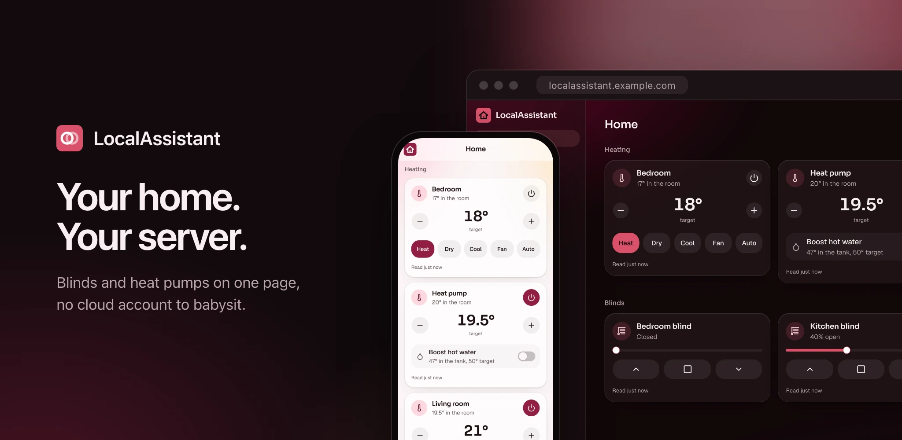

<!-- markdownlint-disable MD041 -->



# LocalAssistant

Your blinds, heat pumps, radiators, cameras and energy on one page, on a server
you run. A small, self-hosted alternative to Home Assistant that installs on
your phone like an app.

## What it does

- **Tuya blinds over your network**: open, close, stop or move to a position,
  straight to the motor with its local key. No Tuya cloud at runtime.
- **Mitsubishi heat pumps**, through MELCloud or locally through an ESPHome
  CN105 adapter: power, mode, target and room temperature, and hot water boost
  on air-to-water (Ecodan) units.
- **Zigbee through Zigbee2MQTT**: door and window sensors, radiator valves,
  relays, metering plugs and the ZLinky reader, all on their own once paired.
- **Energy**: Shelly meters and metering plugs per appliance, the Linky for the
  house (ZLinky or Enedis online), per day and per month.
- **Automations** run by the server: sunrise, sunset, a time on chosen days or
  the outside temperature, limited to seasons or dates, driving blinds by room,
  heat pumps, printers and the vacuum. Presets like radiators off while a window
  is open.
- **Cameras**: RTSP cameras watched and recorded on the server in five-minute
  files with a retention, or a Frigate NVR with its events, clips and detection
  notifications. The Bambu printer's camera on its card.
- **Bambu Lab printers over your network** and **Dreame robot vacuums** through
  the Dreamehome cloud.
- **Weather and a wall panel**: the time and forecast on Home, and a screen for
  a wall tablet or a Shelly Wall Display that stays on.
- **Phones as devices**: each phone in the house with its owner, battery and, if
  shared, where it is.
- **AI apps**: Claude, ChatGPT or Gemini drive the house over MCP, each person
  signing in and allowing their own app.
- **Instant controls**: every tap shows on the card at once and goes out as one
  command when you stop, with a spinner while it's sent and no pop-ups.
- **Your house**, or several: floors, rooms with icons, outside ones like the
  garage, and each device in a room or the whole house. JSON import and export.
- **Accounts for the household**, invite-only: the admin adds devices, everyone
  signed in drives them. Authenticator apps, passkeys, single sign-on and email
  sign-in when you want them.
- **Installable on phones**, with a desktop layout that uses the screen.

## Documentation

The full documentation lives in [`docs/`](docs/): install and configuration,
first run, and how to get each device's credentials.

## Install

LocalAssistant is one container and one SQLite file. The image,
[`docker.io/orochibraru/localassistant`](https://hub.docker.com/r/orochibraru/localassistant),
is built for `linux/amd64` and `linux/arm64`.

```bash
mkdir localassistant && cd localassistant
curl -fsSLO https://raw.githubusercontent.com/orochibraru/localassistant/main/compose.prod.yaml
printf 'AUTH_SECRET=%s\nORIGIN=http://192.168.1.10:3000\n' "$(openssl rand -base64 32)" > .env
docker compose -f compose.prod.yaml up -d
```

Run it on a machine in the same network as the blinds: the container talks to
them directly. Keep `AUTH_SECRET` with your backups: it signs sessions and
encrypts the Tuya keys and the MELCloud password stored in the database.

Behind an HTTPS reverse proxy that sets `X-Forwarded-Proto` and
`X-Forwarded-Host`, leave `ORIGIN` empty. On plain HTTP with no proxy, `ORIGIN`
must be the exact URL you open, or every form is refused as cross-site.

Every variable is in [Configuration](docs/configuration.md).

### First run

Every page sends a fresh instance to the setup screen, which asks for the code
the server's log shows:

```bash
docker compose -f compose.prod.yaml logs localassistant | grep "Setup code"
```

Enter it, then create your account: it's the admin. Then **House** and
**Devices**: connect MELCloud, add each blind. See
[First run](docs/first-run.md).

### Upgrades

```bash
docker compose -f compose.prod.yaml pull
docker compose -f compose.prod.yaml up -d
```

Migrations run at boot. Your data is the `localassistant` volume.

## Contributing

See [CONTRIBUTING.md](CONTRIBUTING.md).

## License

[MIT](LICENSE)
